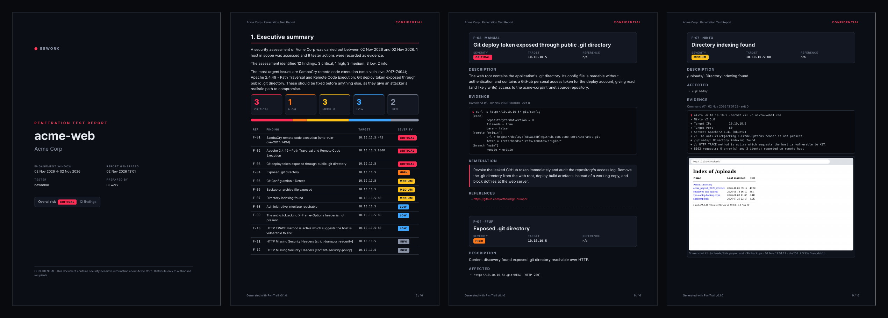

<h1 align="center">● PwnTrail</h1>

<p align="center">
  <b>Record your pentest while you hack. Get the evidence timeline and the report for free.</b>
</p>

<p align="center">
  
  
  
  
</p>

<p align="center"></p>

---

Report writing is the worst part of every engagement. You hack for 3 days, then spend 2 more digging through
terminal scrollback, re-running commands for screenshots and copy-pasting scanner output into Word.

**PwnTrail fixes that.** Run `pwntrail start` and hack like normal. Every command, its full output, exit code,
working directory and timestamp are recorded silently. Import your scans, and one command later you have a
client-ready report where every finding is backed by the exact command that proved it.

## Features

| | |
|---|---|
| 🎥 **Silent recorder** | Wraps your bash/zsh in a pty. Every command and its output is captured per command, with zero slowdown. Your prompt, aliases and config stay exactly as they are. |
| 🛡️ **Scope guard** | Warns you **before** a command touches an IP or domain outside the agreed scope. Ask, block or log-only modes. Every override ends up in the report. |
| 🔒 **Auto-redaction** | Passwords, hashes, API keys, JWTs, bearer tokens, private keys and URL credentials are masked before they ever hit disk. Tool-aware (`hydra -p`, `nxc -H`, `mysql -p`, impacket `user:pass@`, `xfreerdp /p:`). |
| ⛓️ **Chain of custody** | Every command, screenshot, import and note is SHA-256 hashed into a tamper-evident hash chain. `pwntrail verify` proves nothing was edited after the fact. |
| 📥 **Scan importers** | nmap XML, nuclei JSONL, ffuf JSON, nikto XML/JSON. Findings are de-duplicated and automatically linked to the command that produced the file. |
| 🕒 **Interactive timeline** | One self-contained dark HTML page of the whole engagement. Search output, filter by target or tool, expand any command. |
| 📄 **Report generator** | Cover, executive summary, scope, findings with evidence and fixes, attack surface, activity log and integrity appendix. Dark or light. HTML, Markdown and PDF. |
| ✈️ **Fully offline** | No cloud, no telemetry, no DNS lookups. Your client data never leaves your machine. |

## Install

```bash
pipx install pwntrail            # recommended
pipx inject pwntrail weasyprint  # optional: PDF export

# or from source
git clone https://github.com/beworkall/pwntrail && cd pwntrail
pipx install .
```

Works on **Kali, Parrot, Ubuntu, Debian, Arch, macOS** and **Windows through WSL2**. Needs Python 3.9+ and bash or zsh.

## 60-second tour

```bash
# 1. new engagement with its scope (! = excluded)
pwntrail new acme-web --scope 10.10.10.0/24,acme.htb,!10.10.10.13 --client "Acme Corp" --tester you

# 2. start recording, then just hack
pwntrail start
● pwntrail:acme-web $ nmap -sC -sV -oX nmap.xml 10.10.10.5
● pwntrail:acme-web $ nuclei -u http://10.10.10.5 -jsonl -o nuclei.jsonl
● pwntrail:acme-web $ curl -s http://10.10.10.5/.git/config
● pwntrail:acme-web $ nmap -p- 10.10.10.13

⚠  OUT OF SCOPE  10.10.10.13
   Run it anyway? [y/N] n
   skipped.

● pwntrail:acme-web $ pwntrail note "deploy token in /.git/config" --target 10.10.10.5
● pwntrail:acme-web $ pwntrail shot --select --note "/uploads/ directory listing"
● pwntrail:acme-web $ exit
■ recording stopped · 5 commands saved to case acme-web

# 3. import scans (auto-linked to the commands that made them)
pwntrail import nmap.xml nuclei.jsonl
✔ nmap.xml (nmap) 1 hosts, 4 services, 1 findings · linked to command #1
✔ nuclei.jsonl (nuclei) 5 findings · linked to command #2

# 4. add your own finding, with the curl output as evidence
pwntrail finding add --title "Git deploy token exposed" --severity critical --cmd 3

# 5. ship it
pwntrail report --format all --open
pwntrail timeline --open
```

## Commands

| Command | What it does |
|---|---|
| `pwntrail new <name> --scope ...` | Create an engagement and make it active |
| `pwntrail list` / `use <name>` / `status` | Manage and inspect cases |
| `pwntrail start` / `stop` | Start / stop a recorded shell (`exit` also stops) |
| `pwntrail note "text" [-t host]` | Timestamped note on the timeline |
| `pwntrail shot [--select] [--note] [--file img]` | Screenshot as evidence (grim, maim, scrot, flameshot, spectacle, gnome-screenshot, screencapture) |
| `pwntrail log` / `show <id>` | List commands / show one with full output |
| `pwntrail import <files or folders>` | Import nmap, nuclei, ffuf, nikto results |
| `pwntrail finding add/list/show/edit/link/rm` | Manage findings and their evidence |
| `pwntrail scope show/add/rm/guard` | Change scope or the guard mode (`ask`, `block`, `log`) |
| `pwntrail timeline [--open]` | Interactive HTML timeline |
| `pwntrail report [-F html,md,pdf] [--theme light] [--logo] [--company]` | Generate the report |
| `pwntrail verify` | Check the chain of custody |
| `pwntrail export` | Zip the whole case with a SHA-256 manifest |

## How it works

```
 your keyboard ──▶ PwnTrail pty ──▶ bash / zsh (your normal config + tiny hooks)
                      │                 │
                      │◀── output ──────┘   hooks print invisible markers:
                      │                     ESC]7777;S;<cmd>;<cwd>BEL  ...  ESC]7777;E;<exit>BEL
                      ▼
       strip markers → your terminal (looks exactly the same)
       slice output per command → redact → SQLite case file → SHA-256 custody chain
```

No Python process runs per command. The only exception is the scope check, and it only runs when the
command line contains something that looks like a host.

Each case lives in `~/.pwntrail/cases/<name>/`:

```
case.db               commands, findings, notes, custody chain (SQLite)
evidence/sessions/    raw terminal transcript of every session
evidence/shots/       screenshots
evidence/imports/     original scanner files (hashed)
reports/              timeline.html, report .html/.md/.pdf
```

## Scope syntax

```
10.10.10.5          single IP              acme.com       domain + every subdomain
10.10.10.0/24       CIDR                   *.acme.com     same as above
10.10.10.1-50       range (last octet)     !dev.acme.com  excluded host
10.0.0.1-10.0.1.20  full range             !10.10.10.13   excluded IP (always wins)
```

Lab TLDs like `.htb`, `.thm`, `.local`, `.corp` and `.internal` are understood. Loopback is always allowed.

## Limitations (v0.1)

- Shells: bash and zsh. fish and PowerShell are planned.
- Full-screen programs (vim, htop, msfconsole TUI) are kept in the session transcript, not sliced per command.
- Commands you run on a remote box over SSH are recorded as part of the `ssh` command's output.
- Recording needs Linux or macOS. On Windows, use WSL2.

## Roadmap

- [ ] Offline AI write-ups via Ollama (drafts descriptions from the evidence, nothing sent to the cloud)
- [ ] Burp Suite XML importer and MITRE ATT&CK mapping
- [ ] `pwntrail watch` live terminal dashboard
- [ ] OSCP, bug bounty and client report templates
- [ ] fish shell and PowerShell transcript support

## Contributing

Importers, redaction rules and report templates are very welcome. See [CONTRIBUTING.md](CONTRIBUTING.md).
Found a security bug? Please report it privately, see [SECURITY.md](SECURITY.md). Release notes live in
[CHANGELOG.md](CHANGELOG.md).

## Legal

PwnTrail is a documentation tool for **authorised** security testing. Only test systems you have written
permission to test. The scope guard is a safety net, not a substitute for knowing your rules of engagement.

## License

MIT © BEwork · Made by [@beworkall](https://github.com/beworkall)
